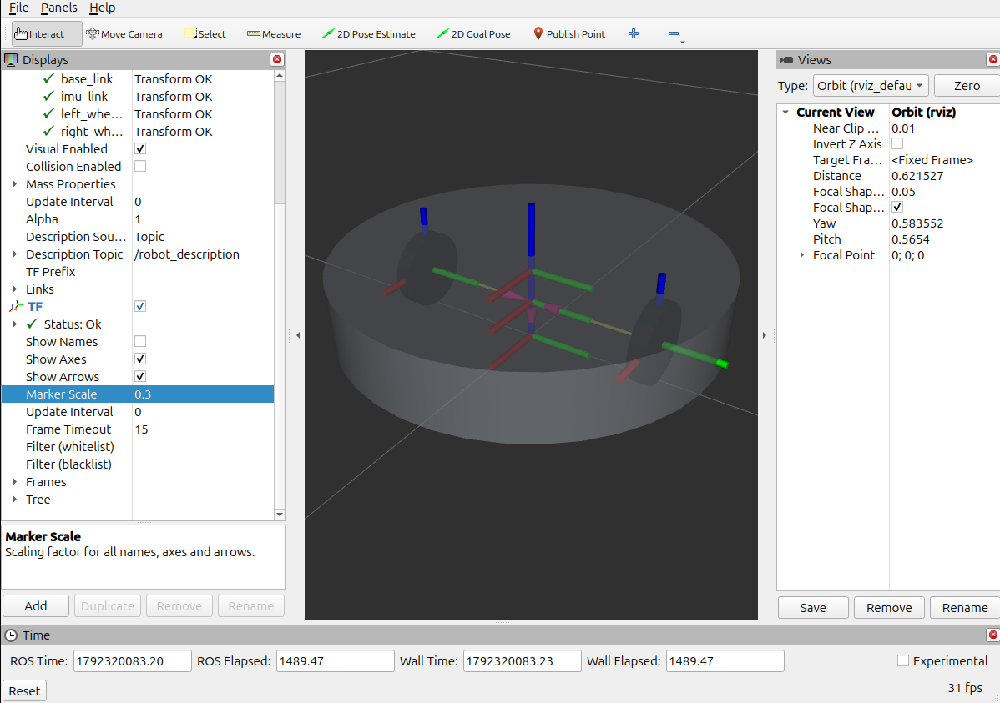

# Autonomous Mobile Robot (AGV)

An autonomous mobile robot built on a Raspberry Pi 5 and ROS 2. It uses a LiDAR salvaged from a robot vacuum cleaner for mapping (SLAM) and navigation.

## Architecture

```
LiDAR YDS2MD-1 ──UART 115200──▶ ESP32-C3 SuperMini ──USB-C──▶ Raspberry Pi 5
  (TX data)                       - packet parsing              - ROS 2 Jazzy
  (M_SCTR ◀── PWM)                - motor control               - lidar_bridge → /scan
                                  - scan forwarding (binary)    - SLAM + wheel odometry
```

## Hardware

| Component | Role | Notes |
|---|---|---|
| Raspberry Pi 5 | Onboard computer, ROS 2 | |
| ESP32-C3 SuperMini | LiDAR ↔ Pi interface | Connected over USB-C |
| LiDAR YDS2MD-1 (EAI) | 360° scanning | OEM variant of the YDLIDAR X2/X2L family. See [firmware_lidar/README.md](firmware_lidar/README.md) |
| ESP32 DevKit (38 pins) | Wheel motors and encoders ↔ Pi interface | ESP32-D0WD-V3 |
| L298N | Dual H-bridge for the two wheel motors | Motor supply 14.7 V, PWM from the ESP32 |
| Roomba wheel modules ×2 | Drive wheels | Gear motor with a single-channel Hall encoder |
| BMI160 | IMU (I2C) | Read by the wheel ESP32 at 50 Hz, in the centre of the robot |

## Wiring

### LiDAR


The LiDAR's 4-wire connector goes to the ESP32-C3 SuperMini: TX → GPIO20, M_SCTR → GPIO3, 5V and GND to the board. Bottom left: the LiDAR bracket. Details in [firmware_lidar/README.md](firmware_lidar/README.md).

### Wheels


| From | To |
|---|---|
| L298N ENA, IN1, IN2 (left motor) | ESP32 GPIO14, GPIO27, GPIO26 |
| L298N IN3, IN4, ENB (right motor) | ESP32 GPIO25, GPIO33, GPIO32 |
| L298N 12V / GND | 14.7 V motor supply; GND shared with the ESP32 |
| Encoder signal, left / right | ESP32 GPIO18 / GPIO19 |
| Encoder power | ESP32 VIN (5 V) and GND |
| BMI160 SDA / SCL, power | ESP32 GPIO21 / GPIO22, 3V3 and GND; CS to 3V3 (I2C mode), SAO to GND (address 0x68) |

The ENA/ENB jumpers on the L298N are removed: the motor speed is set by PWM from the ESP32. Top left: the encoder on the back of a wheel motor. Bottom left: the ESP32 ↔ BMI160 wiring on its own.

## Robot model in RViz2

The first custom Xacro model was checked in RViz2 on 2026-10-18: a 340 mm diameter chassis, 60 mm high and 20 mm above the floor, with 70 mm wheels spaced approximately 235 mm apart. The IMU frame is centred in the body, 65 mm above the floor.



Preview with stationary wheels and TF axes enabled. RViz reports valid transforms for the base, both wheels and `imu_link`. The transparent body makes the internal frames visible; red, green and blue mark the X, Y and Z axes. This checks the model display and TF tree; live encoder feedback and odometry are separate steps. The screenshot shows the model before adding the LiDAR frame. Its scan origin is now set 65 mm above and 115 mm behind the IMU, on the centreline (measured on 2026-10-20); scan orientation remains to be checked.

Model, dimensions and launch instructions: [agv_description](raspberry/src/agv_description/README.md).

## Repository layout

| Folder / file | Contents |
|---|---|
| [firmware_lidar/](firmware_lidar/) | PlatformIO firmware for the ESP32-C3 that reads the LiDAR |
| [firmware_wheels_imu/](firmware_wheels_imu/) | PlatformIO firmware for the ESP32 that drives the wheel motors, reads the encoders and the IMU, and talks to ROS 2 over micro-ROS |
| [raspberry/](raspberry/) | ROS 2 workspace with the nodes that run on the Raspberry Pi |
| [docs/devlog.md](docs/devlog.md) | Development log (chronological) |
| [docs/caseLidar.zip](docs/caseLidar.zip) | Files to 3D print the LiDAR case |

## Project status

| Part | Status |
|---|---|
| LiDAR identification and pinout | ✅ Done and verified |
| LiDAR ↔ ESP32-C3 wiring | ✅ Done |
| LiDAR test (throwaway sketch using the kaiaai/LDS library) | ✅ About 8.3 scans/s, consistent data |
| ESP32-C3 firmware (parser + USB output) | ✅ Working on the hardware: ~8 scans/s, no checksum or CRC errors |
| ROS 2 `/scan` topic (`lidar_bridge`, C++) | ✅ Published at ~8 Hz; angle convention still to check on the robot |
| Wheel encoders (ESP32 firmware, block 1) | ✅ Counting verified on both wheels: 516.6 transitions per revolution |
| Wheel motors, open loop (block 2) | ✅ Directions verified; 11.4-11.8 rad/s at full duty |
| Wheel speed in rad/s (block 3) | ✅ Spread below 1% at ~7 rad/s |
| Wheel speed PID (block 4) | ✅ Holds 2-8 rad/s within 0.01 rad/s; transients to retune on the ground |
| Wheel command watchdog (block 5) | ✅ Wheels stop 0.5 s after the last command |
| IMU on the wheel ESP32 (block 6) | ✅ Acceleration and angular rate in the robot frame, 90° turn read as 90.5° |
| micro-ROS node on the wheel ESP32 (block 7) | ✅ Wheel states and IMU out, wheel speed targets in (test T8) |
| Robot model (`agv_description`) | ✅ Chassis, wheel, IMU and LiDAR frames shown in RViz2 (static preview) |
| Wheel PI transients retuned on the ground | ⏳ To do |
| Wheel odometry (`agv_odometry`) | 🔧 Node written and checked with simulated wheel data; to test on the robot |
| SLAM | ⏳ To do |
| ESP32-C3 enclosure (OpenSCAD) | ✅ STLs generated |
| LiDAR bracket (Fusion) | 🔍 To check: tolerances and mounting |

What was done and when is recorded in the [development log](docs/devlog.md).

## License

Apache 2.0, see [LICENSE](LICENSE).
