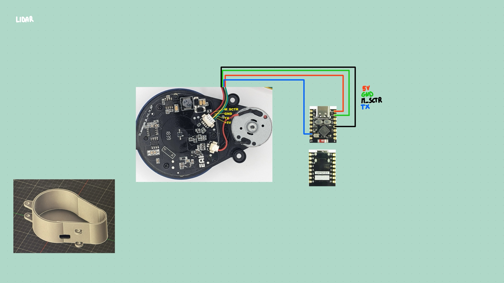
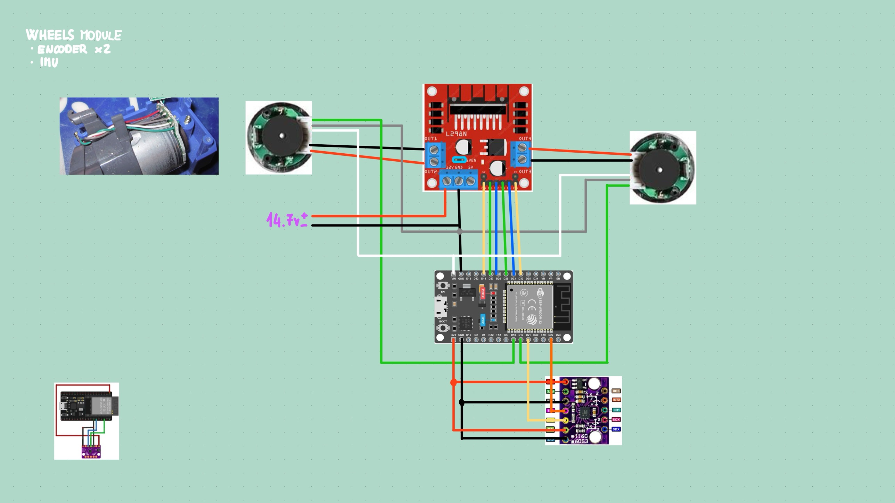

# Autonomous Mobile Robot (AGV)

An autonomous mobile robot built on a Raspberry Pi 5 and ROS 2. It uses a LiDAR salvaged from a robot vacuum cleaner for mapping (SLAM) and navigation.

## Architecture

```
LiDAR YDS2MD-1 ──UART 115200──▶ ESP32-C3 SuperMini ──USB-C──▶ Raspberry Pi 5
  (TX data)                       - packet parsing              - ROS 2 Jazzy
  (M_SCTR ◀── PWM)                - motor control               - lidar_bridge → /scan
                                  - scan forwarding (binary)    - SLAM + wheel odometry
```

## Hardware

| Component | Role | Notes |
|---|---|---|
| Raspberry Pi 5 | Onboard computer, ROS 2 | |
| ESP32-C3 SuperMini | LiDAR ↔ Pi interface | Connected over USB-C |
| LiDAR YDS2MD-1 (EAI) | 360° scanning | OEM variant of the YDLIDAR X2/X2L family. See [firmware_lidar/README.md](firmware_lidar/README.md) |
| ESP32 DevKit (38 pins) | Wheel motors and encoders ↔ Pi interface | ESP32-D0WD-V3 |
| L298N | Dual H-bridge for the two wheel motors | Motor supply 14.7 V, PWM from the ESP32 |
| Roomba wheel modules ×2 | Drive wheels | Gear motor with a single-channel Hall encoder |
| BMI160 | IMU (I2C) | Wired, not used yet |

## Wiring

### LiDAR



The LiDAR's 4-wire connector goes to the ESP32-C3 SuperMini: TX → GPIO20, M_SCTR → GPIO3, 5V and GND to the board. Bottom left: the LiDAR bracket. Details in [firmware_lidar/README.md](firmware_lidar/README.md).

### Wheels



| From | To |
|---|---|
| L298N ENA, IN1, IN2 (left motor) | ESP32 GPIO14, GPIO27, GPIO26 |
| L298N IN3, IN4, ENB (right motor) | ESP32 GPIO25, GPIO33, GPIO32 |
| L298N 12V / GND | 14.7 V motor supply; GND shared with the ESP32 |
| Encoder signal, left / right | ESP32 GPIO18 / GPIO19 |
| Encoder power | ESP32 VIN (5 V) and GND |
| BMI160 SDA / SCL, power | ESP32 GPIO21 / GPIO22, 3V3 and GND |

The ENA/ENB jumpers on the L298N are removed: the motor speed is set by PWM from the ESP32. Top left: the encoder on the back of a wheel motor. Bottom left: the ESP32 ↔ BMI160 wiring on its own.

cd ~/agv/autonomous-mobile-robot/firmware_wheels
~/.platformio/penv/bin/pio run -t upload --upload-port /dev/ttyUSB0
~/.platformio/penv/bin/pio device monitor --port /dev/ttyUSB0


## Repository layout

| Folder / file | Contents |
|---|---|
| [firmware_lidar/](firmware_lidar/) | PlatformIO firmware for the ESP32-C3 that reads the LiDAR |
| [firmware_wheels/](firmware_wheels/) | PlatformIO firmware for the ESP32 that drives the wheel motors and reads the encoders |
| [raspberry/](raspberry/) | ROS 2 workspace with the nodes that run on the Raspberry Pi |
| [docs/devlog.md](docs/devlog.md) | Development log (chronological) |

## Project status

| Part | Status |
|---|---|
| LiDAR identification and pinout | ✅ Done and verified |
| LiDAR ↔ ESP32-C3 wiring | ✅ Done |
| LiDAR test (throwaway sketch using the kaiaai/LDS library) | ✅ About 8.3 scans/s, consistent data |
| ESP32-C3 firmware (parser + USB output) | ✅ Working on the hardware: ~8 scans/s, no checksum or CRC errors |
| ROS 2 `/scan` topic (`lidar_bridge`, C++) | ✅ Published at ~8 Hz; angle convention still to check on the robot |
| Wheel encoders (ESP32 firmware, block 1) | ✅ Counting verified on both wheels: 516.6 transitions per revolution |
| Wheel motors, open loop (block 2) | ✅ Directions verified; 11.4-11.8 rad/s at full duty |
| Wheel speed estimate, PID, watchdog (blocks 3-5) | ⏳ To do |
| Wheel odometry | ⏳ To do |
| SLAM | ⏳ To do |
| ESP32-C3 enclosure (OpenSCAD) | ✅ STLs generated |
| LiDAR bracket (Fusion) | 🔍 To check: tolerances and mounting |

What was done and when is recorded in the [development log](docs/devlog.md).

## License

Apache 2.0, see [LICENSE](LICENSE).
